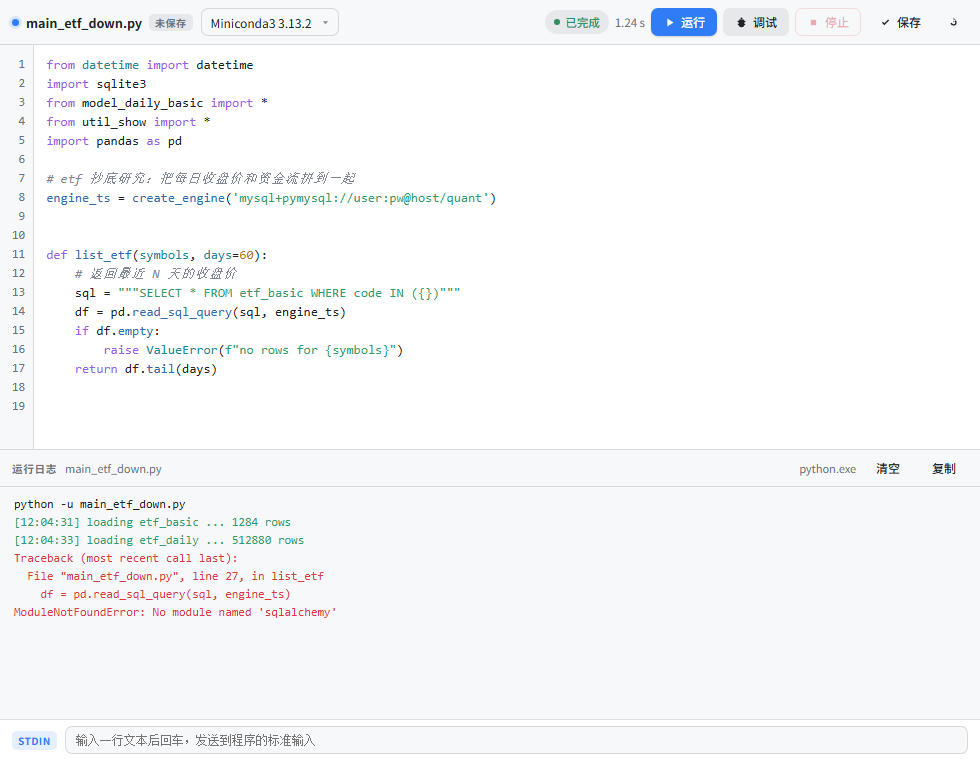

# dsh-py-runner

在 DSH 侧边栏里直接跑 Python：打开 `.py` 文件就能看到编辑器、**运行 / 调试** 按钮和实时输出日志，不用切终端。

 

## 它能做什么

- **打开就能跑**：`.py` 文件被接管成自己的视图，顶部一排 `运行` / `调试` / `停止` / `保存`，下面就是日志面板。
- **实时日志**：stdout / stderr 分色流式输出，自动滚到底；手动往上翻就不再打扰你。退出码与耗时显示在工具条上。
- **调试**：调试模式用 `python -m pdb` 启动，面板底部的输入框直接敲 pdb 命令（`n` 单步、`s` 进入、`c` 继续、`l` 看代码、`p x` 打印变量），↑/↓ 翻历史。
- **交互式 stdin**：非调试模式运行时，同一个输入框就是程序的标准输入。
- **轻量编辑**：行号、Tab 插 4 空格、`Ctrl+S` 保存、`Ctrl+Enter` 运行、`Ctrl+Shift+Enter` 调试。
- **独立标签页**：左侧栏还有「Python 运行器」标签，切换文件时日志不中断（每个会话一个运行上下文）。
- **多解释器**：自动探测 Miniconda / Anaconda / DSH 自带 Python / PATH，工具条里可切换，选择会被记住。

## 界面



- 工具条：文件名 + `未保存` / 编码标记，中间留白，右侧是状态胶囊（空闲 / 运行中 / 已完成 / 退出码 N）、耗时和操作按钮。
- 日志栏右侧有 `清空` 与 `复制`；`清空` 只清显示，不会打断正在跑的程序。
- 所有配色取宿主 token（`--dsw-alias-*`），亮色 / 暗色主题都跟着走。
- 交互态（hover、focus、滚动条）写在注入到 `<head>` 的一小段样式表里，一次性注入、id 为 `dsh-py-runner-styles`。

> `tools/preview.mjs` 会从 `lib/client.js` 里抽出同一份样式表，生成 `.preview/ui-{light,dark}.html` 静态预览，改界面时不用来回重启 DSH 就能看效果。

## 安装

三种装法，按场景挑一种：

```powershell
# 1) 从 GitHub（市场收录后卡片给的就是这条，无需 npm）
dsh plugin --profile desktop add "github:amzingluo/dsh-py-runner"

# 2) 从 npm（发布过 npm 才有这条）
dsh plugin --profile desktop add dsh-py-runner

# 3) 本地开发：链接到源码目录，改完 lib/*.js 重启即生效
dsh plugin --profile desktop add "file:C:/Users/17871/Documents/Obsidian Vault/probability/dsh-py-runner"
```

然后把 `dsh-py-runner` 加进 `C:\Users\17871\.dsh\profiles\desktop\package.json` 的 `dsh.profile.bundles` 数组，重启 DSH。

> 第 1 种装法要求机器上装了 **git**（pnpm 会用 `git ls-remote` 解析仓库再下 tarball，没有 git 会报 `ERR_PNPM_GIT_RESOLVE_FAILED`）。Windows 上 `winget install Git.Git` 即可。

> 想上架 DSH 市场看 [PUBLISHING.md](PUBLISHING.md)：市场读的是 awesome-dsh-plugin 的列表，收录靠一个 YAML PR，npm 不是必需项。

## 安全边界

- 所有文件读写都限制在**当前会话的工作目录**内（`requireInside` 前缀校验，`..` 逃逸直接拒绝）。
- 运行/保存等 POST 接口会校验 GUI 会话（`connection.browserAuth`），非浏览器请求返回 401。
- 只读不写的地方：文件列表深度 3、最多 500 个 `.py`；单文件编辑上限 4 MB；单次运行输出上限 80 万字符（超出从头丢弃并在日志里提示）。

## 结构

| 文件 | 作用 |
| --- | --- |
| `lib/runner.js` | 子进程生命周期：spawn、输出缓冲（带 `seq` 可重放）、stdin、`taskkill` 杀进程树、pdb 结束自动退出 |
| `lib/index.js` | 宿主侧 HTTP 路由 `/dsh-py-runner/api/{info,read,save,run,stop,stdin}` + SSE `/events` |
| `lib/client.js` | 手写客户端 bundle：`registerTab` + `registerFileViewer`，Controller 状态机 + Workbench UI |
| `test/smoke.mjs` | runner 单测（真跑 Python，含 pdb、runaway 输出、杀进程树） |
| `test/host.mjs` | 路由集成测试（假 ctx + 真 HTTP） |
| `test/highlight.mjs` | 语法高亮扫描器单测（纯文本、各类 token、超大文件回退） |
| `test/ui.mjs` | 假 React 渲染 Workbench，校验扩展点注册、样式注入、工具栏结构与空状态 |
| `tools/preview.mjs` | 生成 `.preview/ui-*.html` 静态界面预览 |

跑测试（需要放开沙箱权限，因为沙箱禁止管道 stdio）：

```powershell
$node = "C:\Users\17871\.dsh\dsh-runtimes\dsh-primary-runtime\dependencies\node\bin\node.exe"
& $node test\smoke.mjs
& $node test\host.mjs
& $node test\highlight.mjs
& $node test\ui.mjs

# 看界面：生成静态预览后直接用浏览器打开 .preview\ui-light.html
& $node tools\preview.mjs
```

## 已知边界

- 不是 DAP 调试器：没有断点面板、变量树、调用栈——就是 pdb 的命令行体验。
- 语法高亮是自带的小型 Python 扫描器（注释 / 字符串 / 数字 / 关键字 / 装饰器 / 函数调用），不是完整 parser；超过 20 万字符的文件自动退回纯文本。
- 非 UTF-8 文件（例如 `#encoding:gbk` 的老脚本）会按 GBK 解码显示，但编辑器**只读**——没有 GBK 编码器，写回会把文件改坏。运行、调试不受影响。
- 每个会话的运行上下文只存在内存里，DSH 重启后日志清空。
